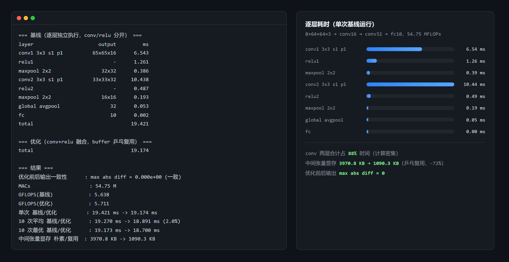

# micro-infer

一个只跑 CNN 的端侧推理引擎内核，用来把「算子 → 图优化 → 内存规划 → 性能度量」这条链路摸清楚。

不是又一个深度学习框架：没有训练、没有自动求导、没有 ONNX 解析。目标只有一个 —— 弄清楚一次推理里，时间到底花在哪、显存到底被谁占掉、融合到底省了什么。

## 现在有什么

| 模块 | 内容 |
|---|---|
| 算子 | NHWC 布局的 conv2d、relu（原地/独立输出两版）、maxpool 2x2、global avgpool、fc |
| 布局选择 | NHWC：最后一维是通道，一次访存能取到同一像素的多个通道，比 NCHW 友好 |
| 优化 | conv+relu 融合（省掉一次完整遍历）、两块缓冲乒乓复用（中间张量不叠加） |
| 度量 | 逐层耗时、端到端耗时、MACs、GFLOPS、朴素/复用两种显存占用 |
| 正确性 | 优化前后输出逐元素比对；另附 numpy 参考实现做独立对拍 |



## 跑起来

```bash
# MinGW / Linux 均可，无第三方依赖
g++ -std=c++17 -O2 -static -Isrc src/*.cpp -o micro-infer

./micro-infer          # 跑基准 + 优化，打印逐层耗时与汇总
./micro-infer dump     # 额外导出 dump_*.bin，供 python 参考实现对拍
python python/ref.py   # 需要 numpy
```

模型：输入 `8×64×64×3` → conv3x3(16) + relu → maxpool → conv3x3(32) + relu → maxpool → GAP → fc(10)，约 **54.75 MFLOPs**。

## 实测（Windows 11 / MinGW g++ 16.2 -O2，单线程）

```
layer                      output         ms
conv1 3x3 s1 p1           65x65x16      6.628
relu1                           -      0.531
maxpool 2x2                 32x32      0.512
conv2 3x3 s1 p1           32x32x32     11.105
relu2                           -      0.635
maxpool 2x2                 16x16      0.114
global avgpool                 32      0.019
fc                             10      0.000
total                                 19.416

优化后 total                          19.321
```

| 指标 | 值 |
|---|---|
| MACs | 54.75 M |
| GFLOPS | 4.2–5.6（朴素 imp2col 循环，单核；随机器负载浮动） |
| 中间张量显存 | 3970.8 KB → 1090.3 KB（乒乓复用，-72%） |
| 优化前后输出 | max abs diff = 0.000e+00，完全一致 |
| 10 次平均 | 19.270 ms → 18.891 ms（2.0%） |

上面的数字来自单次运行，波动约 ±0.3ms；所以程序默认做 10 次重复，报 **min / 中位 / 均值 / max** 四组数，
`--bench N` 可以改次数：

```bash
./micro_infer --bench 30        # 跑 30 次，四组数一起给
./micro_infer --help
```

`--bench` 只接受 3..100000 的整数：`--bench abc`、`--bench 0`、`--bench 2` 都会退 2。
（以前 `atoi` 会把它们统统变成 1 次，用一次的噪声数照样算出"优化了 x%"。）

**退码也是门禁**：融合实现算错时 `max abs diff` 会超过 1e-4，程序现在以 1 退出并打一行
`error: 优化前后输出不一致`，CI 里直接红；正常退 0，参数错退 2。

**2026-11-18 复测（同一台机器，时段更忙）**：单次在 25–39 ms 之间跳（抖动 45%–52%），20 次最优是
25.887 / 25.555 ms，而中位数是 28.510 / 29.181 ms —— 融合那 2–4% 的收益已经掉进噪声里了。
所以这里的规矩是：**只看最优与中位数，不拿单次数字下判断**；机器负载一高，单次测量能把结论带偏好几倍。

## 逐层性能回归怎么比

控制台那张表只有绝对值，改完代码看一眼「好像差不多」就过去了。所以另加了 CSV 导出 + 对比脚本：

```bash
./micro_infer --csv out/before.csv     # 改代码之前
./micro_infer --csv out/after.csv      # 改代码之后
python tools/diff_csv.py out/before.csv out/after.csv
```

```
layer                     before     after     delta        %
-------------------------------------------------------------
conv1 3x3 s1 p1            6.501     6.540    +0.039    +0.6%
maxpool 2x2                0.199     0.218    +0.019    +9.5%  (幅度小，可能是噪声)
conv2 3x3 s1 p1           10.505    10.477    -0.028    -0.3%
total                     19.543    19.656    +0.113    +0.6%
-------------------------------------------------------------
没有超过 5% 的退化
```

判定规则是**相对 + 绝对同时超阈值**才算退化（`>5%` 且 `>0.15ms`）。
只按百分比会误判——maxpool 本来只有 0.2ms，抖 0.02ms 就是 10%，但它对总耗时毫无影响。
有真退化时脚本返回 2，可以直接放进 CI 当门禁。

**一个诚实的观察**：融合带来的耗时收益只有 0.5%–3%（不同轮次有波动），和我最初的预期差很远。原因是这个模型计算密集（conv 占了 94% 的时间），relu 那一次遍历本来就不贵；融合真正省的是**带宽**和**峰值显存**，只有在访存受限的层（比如 depthwise、逐元素运算占比高的网络）才明显。这一点不实测是想不到的，也说明「融合一定更快」是个想当然的结论。

## 目录

```
src/tensor.h   NHWC 张量
src/ops.h/.cpp 算子实现（朴素版，作为对拍基线）
src/main.cpp   模型装配、逐层计时、优化路径、结果汇总
python/ref.py  numpy 独立参考实现，与 C++ 输出对拍
```

## 已知局限与下一步

- **没有向量化**：conv 是裸三层循环，GFLOPS 只有 5.6；下一步上 im2col + 分块 GEMM，目标是 3–5 倍
- **没有多线程**：单核跑满，多核按行切分互不干扰，收益接近线性
- **量化只留了接口，没实现**：INT8 per-channel 的 scale/zero-point、反量化卷积还没写
- **图优化只有融合**：常量折叠、算子重排、layout 变换都还没做
- **没有真实模型**：只有合成权重，接上 ONNX 或手写一个 LeNet 权重才能真正验证精度
